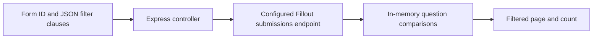

# Form response filter API

A small TypeScript/Express take-home exercise that fetches submissions from a configured Fillout API and filters the returned page by question values. Its single route is `GET /:formId/filteredResponses`.

The important scope boundary: this service fetches one upstream response payload, filters its `responses` array locally, and returns the upstream `pageCount`. It does not exhaust upstream pagination or calculate a new filtered page count. There is no UI.

## Local setup

```sh
npm ci --ignore-scripts
cp .env.example .env
# Configure your own authorized API base URL and token locally.
npm run build
npm start
```

Use Node.js newer than 18.16. The server listens on port 3001. Run commands from the repository root: `npm start` now keeps that working directory, allowing dotenv to find the root `.env`. `npm run dev` runs the TypeScript entry point through nodemon.

The build uses the installed TypeScript compiler directly; the unrelated `tsc` package that shadowed it was removed. Generated `build/` output and duplicate emitted JavaScript beside source files are no longer committed, preventing stale JavaScript from shadowing TypeScript during development.

## Request shape

`filters` is a JSON-encoded query parameter containing clauses with `id`, `condition`, and `value`. Conditions are `equals`, `does_not_equal`, `greater_than`, and `less_than`; values are strings or numbers.

```sh
curl --get 'http://localhost:3001/example-form/filteredResponses' \
  --data-urlencode 'filters=[{"id":"example-question","condition":"equals","value":"Example"}]'
```

The response object contains `responses`, `totalResponses` (the size of the locally filtered array), and `pageCount` copied from upstream. The identifiers and value above are illustrative; they are not a real form or credential.

**Filtering semantics need a product decision.** The current implementation keeps a submission only when **every clause fails to match** (`every(!matches)`), rather than keeping all matches or excluding only submissions that match every clause. That behavior is preserved pending clarification. Numeric comparisons can throw when the requested question is absent. Malformed or omitted filter JSON is not handled as a separately validated request schema. Do not infer a complete search API from this exercise.

## How the pieces fit



[`services/fillout.service.ts`](services/fillout.service.ts) constructs the upstream request using an environment-provided bearer token. [`utils/filter.ts`](utils/filter.ts) handles the comparisons. [`controllers/filteredResponse.controller.ts`](controllers/filteredResponse.controller.ts) assembles the response.

The upstream client currently has no timeout, pagination loop, or explicit non-2xx response check. The public route has no authentication or rate limit, so exposing it could let other callers use the server's upstream access. Error handling also needs a stable public response format. Keep it local with synthetic submissions until those boundaries are addressed.

## Credential and asset cleanup

The tracked `.env` was removed and replaced by a nonfunctional `.env.example`. The exposed authorization value is also removed from rewritten reachable branch history, and future real environment files are ignored. History cleanup cannot revoke a token or erase copies in forks, caches, or other clones; whether this value is real still requires the account owner's confirmation. No credential was tested against a provider.

The unused `public/fonts` folder had valid font signatures but no application references and an unrelated application README. It was removed along with obsolete publisher-artifact ignore entries. Neither was independently sufficient evidence of malware.

## Verification

The TypeScript build is the available automated check for this update. There is no configured behavioral test suite; the existing `npm test` placeholder is not a passing test command. No live Fillout request, real token, full upstream pagination, or deployment was exercised.
